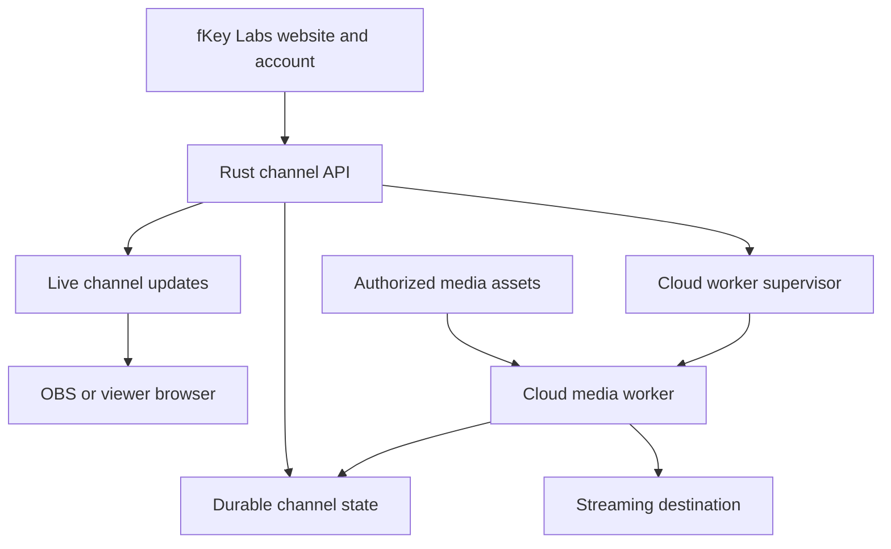

# Playback Cloud: Rust migration and hosted product

## Decision

Build fKey Playback as a shared Rust channel engine with separate local, browser,
and cloud media outputs. Reuse the existing fKey Labs website and account system.
Full cloud broadcasting must continue when the customer's computer and dashboard
are off; it therefore needs a continuously running media worker.

The baseline is Playback v1.2.3, commit
`a70314efdc2feca2c8fe253223b67a178bd9e2d0`. The new `rust/` workspace starts the
migration with a deterministic engine, transactional SQLite storage, and a native
migration/control CLI. It is an engineering milestone, not a replacement for the
current OBS application or a deployable multi-tenant broadcast service.

## Product modes

| Mode | Video playback | Computer requirement | Status in this migration |
| --- | --- | --- | --- |
| Playback Local | Existing local OBS browser source | OBS computer stays on during broadcast | Existing v1.2.3 release |
| Hosted Studio | Hosted queue and management; output in customer OBS | OBS computer stays on during broadcast | Planned Rust service |
| Hosted watch channel | Official YouTube player in each viewer's browser | Owner can disconnect; viewers need browsers | Planned, best-effort synchronization |
| Playback Cloud Channel | Hosted media pipeline sends to streaming destination | Customer PC can be off | Planned, needs media workers |

Do not describe a hosted OBS URL as a cloud broadcaster. A persisted queue alone
does not produce video. The website should distinguish the local download from
Cloud's development status until the complete output path passes acceptance tests.

## Supported media origins

YouTube references use the official Data API for permitted metadata and the
official IFrame Player API for embedded viewing. Their API is a browser player
control interface; it is not a source of raw media packets for a Rust encoder.

Full cloud broadcast initially accepts original or appropriately licensed video
files uploaded by the customer. Additional direct media origins need an explicit
support contract. Content ownership and permission to retrieve it from a platform
are separate questions. Do not turn the existing optional yt-dlp metadata importer
into an unrestricted hosted YouTube download/rebroadcast feature.

For YouTube embed mode, place Playback information beside the video; the required
minimum functionality rules prohibit placing overlays over any part of the
embedded player. Native authorized-media output can composite lower thirds,
scrolling titles and voting screens. Do not promise forced caption suppression,
ad removal or complete YouTube debranding. Sell Playback's scheduling, operation,
moderation and hosting features, rather than charging viewers to watch embedded
YouTube content.

## Runtime architecture

The website remains the storefront and browser dashboard. Its existing hosting
runtime serves that role; a native Rust process and continuous encoding worker
run on infrastructure that supports their runtime and resource requirements.

Start with one modular Rust application and isolated media workers. Avoid one
virtual machine, browser, database connection, or control service per customer.
Use one bounded async task per active channel where appropriate. Import work and
encoding must not block the control runtime.

| Component | Responsibility | Initial technology |
| --- | --- | --- |
| `playback-core` | Queue, rotation, playback observations, voting and deterministic transitions | Rust, Serde |
| `playback-store` | Local durable state and command receipts | Rust, SQLite |
| `playback-cli` | Migration inspection and local engine exercise | Native Rust executable |
| Future service | Identity verification, tenant authorization, HTTP and realtime delivery | Rust, Axum, Tokio |
| Hosted store adapter | Tenant state, atomic commands, outbox, leases and usage | PostgreSQL |
| Integrations | Official playlist metadata and chat events | Bounded Rust background jobs |
| Media worker | Asset playout, audio/video composition, encoding and destination connection | Rust supervision with GStreamer; FFmpeg for inspection/preparation |
| Dashboard | Queue management, settings and scene editing | Reuse existing browser UI initially |

Using Rust for the engine and services does not require rewriting every browser
component in WebAssembly. The browser still needs the YouTube JavaScript bridge.
Moving the proven UI and editors after the backend is stable lowers regression
risk and preserves the fKey Labs design system.

## Durable queue semantics

Keep media identity separate from a queue occurrence. Repeating the same video is
valid; an entry needs its own stable ID. Every playback occurrence also has a
generation, so a delayed end event cannot finish its next appearance.

| Lane or action | Required behavior |
| --- | --- |
| Upcoming | Remaining unplayed entries in this rotation |
| Play Next | Priority entries before ordinary Upcoming entries |
| Recycled | Completed or skipped entries held for later rotation |
| Next Rotation | Explicitly deferred entries, promoted before Recycled |
| Add to Current Rotation | Adds to remaining Upcoming without restarting current playback |
| Play Now | Parks the interrupted current item in Play Next with its saved position |
| Rollover | Happens atomically when Play Next and Upcoming are exhausted and looping is enabled |
| Unavailable | Quarantines the failed entry instead of recycling it forever |

The existing vote-on-end behavior is part of compatibility: a vote may promote the
prior recycled pool at the rotation boundary before the currently ending entry is
recycled. Migrate this deliberately rather than assuming every transition is a
simple pop-and-append operation.

The primary migration fixture is the owner's real use case: 2019–2024 already
recycled, 2025 currently playing, 2026 upcoming, then additional older videos
imported while playback continues. Chronological metadata must not rebuild the
queue or send playback back through the consumed archive.

## Transactions and retries

A service command should include tenant, channel, an idempotency key and an
expected revision. An accepted command commits its result and state change before
the server acknowledges it. Repeating the same command ID returns its earlier
result; reusing that ID with a different request is an error.

For hosted operation, lock/check the channel row, apply the transition, write the
new state and command receipt, append a transactional outbox event, then commit.
Realtime delivery may repeat or disconnect. Clients use revisions to discard old
events and reload a snapshot when needed. Do not claim exactly-once transport.

The SQLite adapter in this branch establishes the transaction contract for local
migration. Its whole-snapshot format prioritizes compatibility and atomicity. It
is not a final hosted performance design: large cloud queues should have indexed,
paginated rows and small active-state updates, and command receipts need an
explicit retention policy before a production service is launched.

## Playback recovery

Store desired playback state separately from observed progress. A timestamp plus
elapsed wall-clock time does not prove that video played. Buffering, a paused
source, a crashed worker and a closed viewer must not all look like successful
playback.

Two explicit policies are useful:

- **Resume where stopped:** resume the same entry from the most recent accepted
  media checkpoint. This is the default corresponding to the current product.
- **Always-live schedule:** the channel timeline progresses by schedule and
  viewers join its current position. This is a planned watch-channel option, not
  evidence that an encoder rendered while absent.

Checkpoint progress periodically and at pause, seek, skip, item change and clean
shutdown. A proposed five-second checkpoint interval permits replay of up to that
uncommitted window, plus any player seek granularity. Measure the actual bound;
do not advertise exact-frame recovery or seamless failover.

A dedicated media worker or OBS output may report authoritative playback
observations. Ordinary public viewers must not advance the global queue. In a
scheduled watch channel, viewer buffering is local and does not stall everyone.

## Worker ownership and failover

Workers acquire renewable channel leases carrying increasing fencing epochs.
Reject stale observations, commands and writes. Check both playback generation
and worker epoch when applying an observation.

Database fencing alone is insufficient. A worker partitioned from the database
could retain its RTMP connection. The output supervisor must stop it before its
authority expires, or an output gateway must enforce the active publisher epoch
and disconnect stale publishers. Test this partition explicitly before enabling
automatic worker replacement.

The first operational target is automatic recovery with measured interruption,
not a claim of uninterrupted failover. Spare worker capacity, destination
reconnect behavior and media reload time all affect that result.

## Efficient media processing

Rust reduces application overhead; it does not remove decode, composition,
encoding or network cost. Three media paths have different economics:

1. Compatible packet passthrough/remux avoids re-encoding. It requires compatible
   inputs and carefully continuous timestamps across assets.
2. Preparing compatible renditions once can lower repeated processing costs at
   the cost of ingest compute and storage.
3. Live lower thirds, moving titles, vote scenes, scaling and audio mixing need a
   composition path, normally decode → compose → encode. Hardware encoding should
   be evaluated using the complete pipeline rather than encoder-only claims.

Do not price dynamic composited broadcasts using a passthrough benchmark. Use a
small initial matrix such as one destination, 720p30/1080p30, and the existing
bounded overlay templates. Validate the actual destination's codec, bitrate and
keyframe requirements rather than using one universal preset.

Represent overlays as a versioned scene description: coordinates, dimensions,
anchor, opacity, colors, text sizes and visibility. The preview and native
compositor should consume that same description. Preserve the current manual
height, background opacity and scrolling-title requirements.

## Bandwidth and pricing model

These are calculations, not hosting-provider quotes. For decimal GB:

`outbound_GB = 0.45 × (video_Mbps + audio_Mbps) × hours × destinations`

For a 30-day, 720-hour month and an illustrative 160 kbps audio track:

| Video bitrate | Monthly output for one destination |
| --- | ---: |
| 3 Mbps | 1,023.84 GB |
| 6 Mbps | 1,995.84 GB |
| 8 Mbps | 2,643.84 GB |

Exclude no real costs when quoting customers: protocol overhead, retries,
monitoring previews, input reads, prepared asset storage, recordings, processing
and recovery capacity can add costs. Two destinations double the media egress
even when one encoder can feed both. A 31-day month is 744 hours.

For a broadcast delivered onward by a platform, outbound traffic primarily
scales with destination count. Direct video delivery from your own CDN introduces
viewer-hours as another major cost driver.

Package by active cloud channel and output profile. Meter worker seconds,
destination bytes, asset byte-hours, preprocessing and simultaneous outputs. Keep
Hosted Studio/control pricing separate from continuous media capacity. Set public
Cloud prices after measuring real per-channel cost and choosing a margin; do not
invent unlimited storage, destinations or a server-density guarantee.

## fKey Labs integration

Use the current fKey Account authority rather than creating a second identity.
The website currently separates identity, product access and media usage; preserve
that separation. Playback cloud limits must be server-issued, product-scoped
entitlements. Existing fStream subscription benefits must not silently grant
unmetered 24/7 encoding.

Add Playback to the product catalog with the actual local v1.2.3 download and an
explicit Cloud-in-development section. Only expose a live account dashboard when
the service and entitlement authority support it. Account deletion/export must
eventually include Playback-owned queues, settings, usage and media according to
the product's retention policy.

Future channel creation should ask for mode and media origin, configure a
destination where relevant, validate the output profile, show included limits,
then provision the channel. Stream credentials remain server-side; neither viewer
links nor OBS source links may grant operator permission.

## Migration and launch sequence

| Milestone | Deliverable | Acceptance condition |
| --- | --- | --- |
| 1. Rust state foundation | Pure engine, SQLite contract, migration CLI | Queue behavior, saved positions, retry and reopen tests pass |
| 2. Service integration | Rust API, fKey identity, tenant authorization, realtime UI adapter | Cross-tenant isolation; existing controls/editors operate through Rust |
| 3. Cloud media | Authorized asset upload, worker supervision, one destination | Complete outgoing broadcast continues with customer devices off |
| 4. Recovery and metering | Worker fencing, restart recovery, durable usage | Failover and retry drills; accurate per-channel resource measurement |
| 5. Limited paid launch | Defined profiles, limits and subscription integration | Sustained run, provider cost and customer onboarding validated |

Preserve the Node release while the Rust engine is exercised against real saved
state. Import to a new store; never overwrite the source `data/` directory. Keep
rollback available until settings, history, audio, votes and integrations have
been verified in the new runtime. Passing core tests does not establish live OBS,
YouTube, Twitch, media-worker or Windows acceptance.

## Measurements and release criteria

- Compare Node and Rust on identical queue sizes and command workloads. Measure
  CPU, RSS, p95/p99 command latency, database write rate and memory growth.
- Separately benchmark media CPU/GPU demand, dropped frames, A/V drift, source
  transitions, output reconnect time and actual outbound bytes.
- Race Skip, end events and vote results; one occurrence must advance once.
- Kill processes before and after a commit; state and command receipts must agree.
- Partition a worker while its destination socket remains alive; stale output must
  not coexist with the replacement publisher.
- Exercise imports, quotas, unavailable media and slow clients without stalling
  unrelated channels.
- Run a representative 24-hour minimum soak, including restarts and a full
  rotation. Increase the duration and scale to the marketed reliability target.

No fixed server capacity, percentage efficiency gain, cloud price or uptime
guarantee is established by this migration milestone.

## Primary references

- [YouTube IFrame API](https://developers.google.com/youtube/iframe_api_reference)
- [YouTube developer policies](https://developers.google.com/youtube/terms/developer-policies)
- [Required minimum functionality](https://developers.google.com/youtube/terms/required-minimum-functionality)
- [Official playlist metadata endpoint](https://developers.google.com/youtube/data/reference/rest/v3/playlistItems/list)
- [Tokio task model](https://tokio.rs/tokio/tutorial/spawning)
- [Axum](https://docs.rs/axum/latest/axum/)
- [PostgreSQL row locking](https://www.postgresql.org/docs/current/explicit-locking.html)
- [FFmpeg stream copy and transcoding](https://ffmpeg.org/ffmpeg.html)
- [GStreamer Rust bindings](https://gstreamer.freedesktop.org/documentation/rust/stable/latest/docs/gstreamer/)

